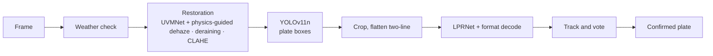
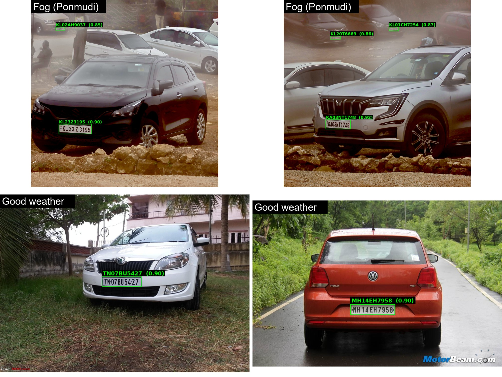
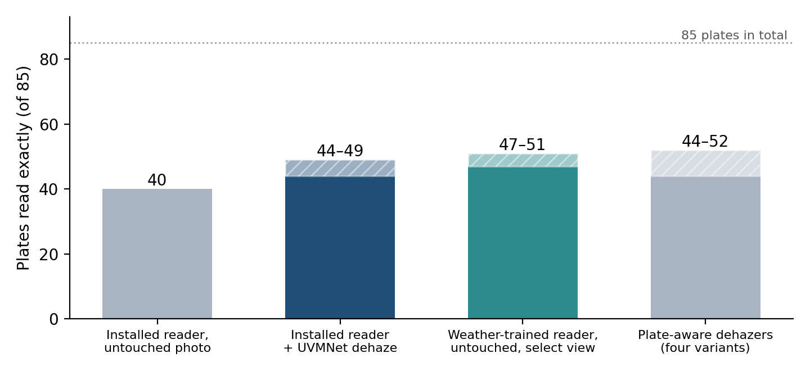
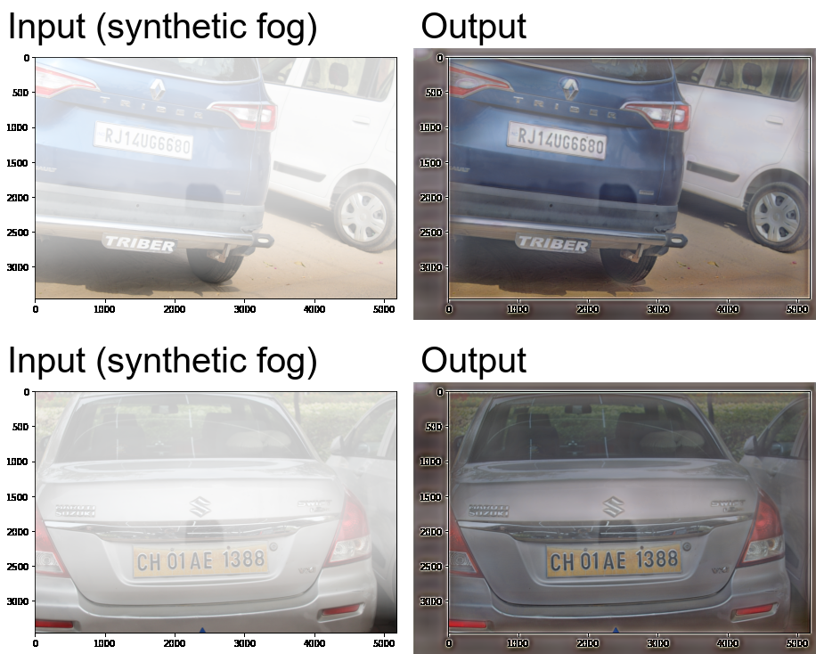
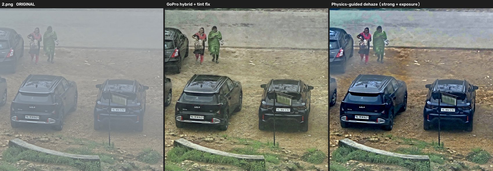
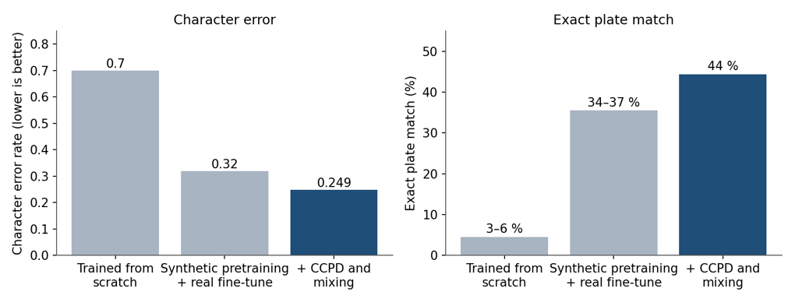
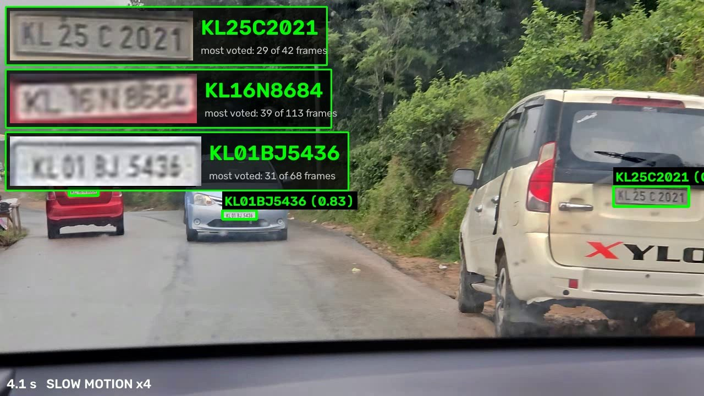

# Weather Adaptive ANPR System

Real-time number-plate recognition for Indian plates in fog, rain and low contrast.
Final-year B.Tech project, Department of Electronics and Communication Engineering,
Government Engineering College Barton Hill, Thiruvananthapuram (APJ Abdul Kalam Technological University), 2026–27.

**Team:** Auxliya Mariya (TRV23EC020), Jewel Mary Varghese (TRV23EC030), Megha T S (TRV23EC039), Silpa C R (TRV23EC066) · **Guide:** Prof. Usha Anand

> **Status:** Phase 1 (the vision core of the camera node) is complete and documented here.
> Phase 2 (vehicle database, alerts, dispatch, multi-node correlation, Jetson deployment) is planned, not built.

---

## What it does

A camera frame goes through weather restoration, a YOLOv11 plate detector, an LPRNet plate reader with Indian plate-format rules, and tracking with voting over frames, so that each vehicle gets one confirmed registration number.



Two orders are supported: restore the whole frame first (used for foggy video, gives the clearest picture) or detect first and restore only the plate crop (cheaper, used in the real-time loop).



## Results (Phase 1)

| Component | Result |
|---|---|
| YOLOv11n plate detector | precision 98.5 %, recall 99.0 %, **mAP@50 99.2 %**, mAP@50–95 85.6 % (15,000+ plate images, 100 epochs) |
| EasyOCR baseline | only 16.5–25.2 % of plates exact in fog, 5.9–11.0 % in rain |
| LPRNet (character error) | 0.70 (from scratch) → 0.32 (synthetic pre-training + real) → **0.249** (+ CCPD and mixing) |
| LPRNet on unseen videos | 38 → **41 of 51** plates exact after two rounds of labelled real-video crops |
| Held-out Rajasthan crops | 48 → **56 of 62** exact (Delhi lettered-RTO layout, red plates and Q added) |
| Real-time pipeline | up to **55 fps** at 1080p on an RTX 4060 laptop GPU; 10 of 12 plates exact on an unseen 4K traffic video |
| UVMNet fog removal | 32.96 dB on traffic haze; 27.30 dB on the combined fog set; 116.2 M parameters |
| Rajasthan hazy photos (250) | 205 of 248 plates right after restoration vs 195 on the hazy originals |
| Deraining network (A5) | 29.19 dB on synthetic rain (22.17 dB unprocessed); 1.72 M parameters |

**The honest finding on real fog.** On 60 real photographs taken at Ponmudi (85 verified plates), every dehazer lifted the installed reader from 40 to 44–49 plates, but none passed the 47–51 that a weather-trained reader gets on the *untouched* photos (test noise about ±3 plates). Restoration helps the viewer more than the reader; combining frames helps the reader (single frame 1 of 36 readings exact, a vote over frames 9, fused 8–10).



### Fog removal

UVMNet is the U-shaped Mamba dehazing network (architecture ported from [UVM-Net](https://arxiv.org/abs/2402.04139), trained by us from random weights; no pretrained dehazing weights are used). The **physics-guided** step uses the network only to *measure* the fog and then inverts the scattering law on the real photograph:

```
I = J·t + A·(1 − t)        →        J = (I − A) / t^γ + A          (γ = 1.25 "strong", then exposure match)
```

| Synthetic fog (input / output) | Real fog at Ponmudi (original / GoPro hybrid / physics-guided) |
|---|---|
|  |  |

### Plate reader and video



LPRNet reads a 200×24 plate crop with CTC loss; two-line plates are flattened first; the raw output is corrected with Indian plate layouts (`LLDDLLDDDD`, `LLDDLDDDD`, 9-character and Delhi lettered-RTO layouts) using the network's own per-position probabilities. For video, readings are voted per vehicle and the final reading is fixed from the first frame.



## Repository layout

| Path | Content |
|---|---|
| `uvm/` | Active code: plate reading (`read_plate.py`, `live_plates.py`, `read_video.py`), reader training (`train_lprnet.py`, …), dehazing (`model_uvmnet.py`, `test_uvmnet.py`, `train_combined.py`, …), browser interface (`plate_app.py`, `foggy_plate_app.py`) |
| `uvm/real_scratch/` | Real-fog training (`train_uvm_real.py`), depth-aware synthetic fog (`depth_fog.py`, `train_uvm_depthfog.py`), video pipeline (`run_video_pipeline.py`), folder runner (`run_anpr_folder.py`) |
| `uvm/foggy_ft/` | Ponmudi study: physics-guided dehaze (`clean/physics_dehaze.py`, `exposure_match.py`, `hybrid.py`), plate-frame fusion (`fusion/`), comparison gallery builder (`gallery/`) |
| `lprnet_export/` | Stand-alone reader package: `predict_plate.py`, `evaluate.py`, `src/` (model and plate-format code), `train/` |
| `yolo_plate_detection/` | Detector training and fine-tuning scripts |
| `dehazing_methods/` | First-stage restoration work: DCP, CLAHE, transformer U-Net, first Mamba model |
| `evaluation/` | OCR baselines and ground truth scripts |
| `report/overleaf/` | The project report (LaTeX, Overleaf-ready) and its figures; `report/ppt_work/` has the scripts that built the slides and diary |
| `documents/` | Results chapters, project diary, review slides, study guide |
| `docs/` | `INTERNAL_FOLDER_MAP.md` (folder map of the original working machine) and the images used in this README |

## What is not in the repository

To keep it small and to avoid publishing photos of real vehicles, the following are **not** included:

- **Datasets** (Ponmudi photos and videos, Rajasthan photos, Foggy-Hazy plates, NH-HAZE, RESIDE, GoPro frames, CCPD, Zenodo plates).
- **Model weights** (`*.pt`): the UVMNet checkpoints are about 465 MB each; the YOLO detector (`yolo_plate_detector_15k_best.pt`) and LPRNet (`lprnet_avg.pt`, 2 MB) are also left out. See [Weights](#weights).
- Large outputs: videos, galleries, comparison folders.

## Setup

The work was developed on Windows 11 with **WSL2 (Ubuntu), Python 3.14 and an NVIDIA RTX 4060 laptop GPU (8 GB)**. UVMNet needs the CUDA `mamba-ssm` kernel, so it runs on Linux/WSL2 with an NVIDIA GPU. The plate reader and detector also run on CPU.

```bash
python -m venv ~/mamba-venv && source ~/mamba-venv/bin/activate
pip install -r requirements.txt
# for UVMNet with the real kernel (Linux / WSL2, CUDA 11.6+):
pip install "causal-conv1d>=1.1.0" mamba-ssm
```

### Weights

Put the weights where the scripts expect them (paths relative to the repository root):

| File | Used for | How to get it |
|---|---|---|
| `uvm/checkpoints_lprnet/lprnet_avg.pt` | plate reader (installed model) | train with `uvm/train_lprnet.py` or ask the team |
| `yolo_plate_detector_15k_best.pt` | plate detector (YOLOv11n, fine-tuned from the Ultralytics `yolo11n.pt`) | train with `yolo_plate_detection/train_15k.py` on a plate dataset |
| `uvm/checkpoints_combined/uvmnet_combined_best_stateonly.pt` | UVMNet (installed) | `uvm/train_traffic.py` then `uvm/train_combined.py` |
| `uvm/checkpoints_ponmudi_gopro/uvmnet_combined_final.pt` | UVMNet used for the foggy pipeline | `uvm/train_uvm_gopro.py` (fine-tuned from the Ponmudi checkpoints) |

## Usage

Run these from `uvm/` inside WSL (`source ~/mamba-venv/bin/activate`).

```bash
# live plate reading on a video (add --yolo_imgsz 1280 for 4K)
python live_plates.py --source <video> --save out.mp4 --log plates.csv

# read plates in photos, with annotated images and crops
python read_plate.py --image_dir <folder> --skip_dehaze --save_annotated <out>/annotated --save_crops_dir <out>/crops

# remove fog from a folder of photos with UVMNet (tiled)
python test_uvmnet.py --input <folder> --checkpoint checkpoints_combined/uvmnet_combined_best_stateonly.pt --output <out>

# YOLOv11 + LPRNet on a folder (annotated images, crops, results.csv)
python real_scratch/run_anpr_folder.py --input <folder> --out <out>

# foggy video: UVMNet + physics-guided dehaze -> YOLOv11 -> LPRNet, with slow motion and a fixed most-voted reading per vehicle
python real_scratch/run_video_pipeline.py --input <folder_of_videos> --out <out>

# browser interface: pick videos or photos and watch the plates appear (http://localhost:8000)
bash start_plate_app.sh
```

The stand-alone reader (`lprnet_export/`) has its own README: `python predict_plate.py --input <crops> --no_detect`.

## Known limits

- Plates only 22–39 px wide (two-wheelers, autos), faded or blurred plates, and plates from some other states are read unreliably.
- Three equal digits in a row are sometimes shortened (a CTC property).
- Deraining is shown on synthetic rain only; its benefit on real rain and on plate reading is not yet measured.
- The foggy-video readings with a low vote share should be treated as unconfirmed.

## Phase 2 (planned)

Vehicle database and status classification, real-time dashboard and alerts, dispatch by road-network distance, multi-node correlation (convoys, route anomalies, loitering), and porting the node to a Jetson-class module (UVMNet's Mamba kernel is CUDA-only, so its latency there is a test).

## Documents

- Project report: `report/overleaf/` (compile `main.tex` with pdfLaTeX on Overleaf).
- Results chapters, project diary, review slides and the study guide: `documents/`.

## References

- Zheng and Wu, *U-shaped Vision Mamba for Single Image Dehazing* (UVM-Net), 2024. · Gu and Dao, *Mamba*, 2023.
- Zherzdev and Gladilin, *LPRNet*, 2018. · Graves et al., *CTC*, 2006.
- Ultralytics YOLO11. · He et al., *Dark Channel Prior*, 2011. · Zuiderveld, *CLAHE*, 1994.
- Yang et al., *Depth Anything V2*, 2024. · Chen et al., *NeRD-Rain*, 2024.
- Datasets: RESIDE, Foggy Cityscapes, NH-HAZE, CCPD, RodoSol-ALPR, a public Zenodo plate set, and our own Kerala, Rajasthan and Ponmudi photographs.

## License

No license has been chosen yet; all rights are reserved by the authors until one is added.
